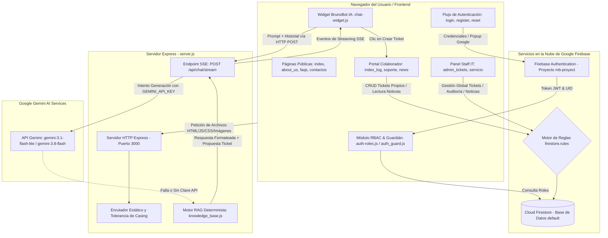
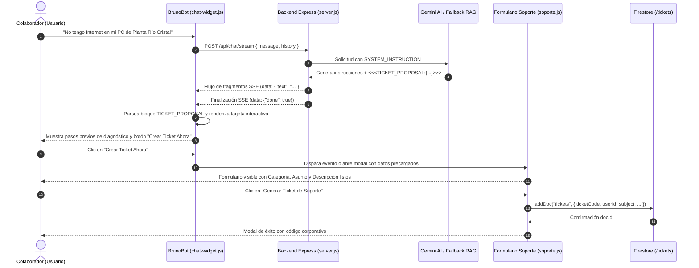
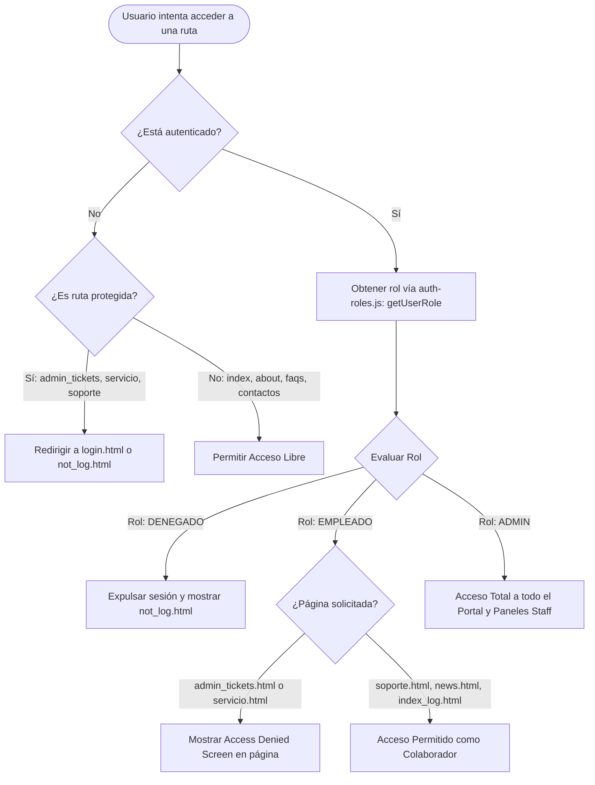

# DOCUMENTACIÓN INTEGRAL Y PROTOCOLO PERMANENTE DE MANTENIMIENTO TÉCNICO
## MINI BRUNO SUCESORES C.A. — PORTAL CORPORATIVO & SUITE DE SOPORTE TÉCNICO (TECHSUPPORT)

> **Archivo Central de Referencia Arquitectónica y Estado Real del Workspace**  
> **Ubicación:** `/info.md`  
> **Versión del Documento:** 1.0.0  
> **Fecha de Creación y Auditoría Inicial:** Octubre 2026  
> **Principio Fundamental:** *No dañar, no regresar funcionalidades, no alterar la arquitectura sin justificación y no modificar componentes fuera del alcance autorizado.*

---

## ÍNDICE GENERAL

1. [A. Identificación del Proyecto](#a-identificación-del-proyecto)
2. [B. Tecnologías y Entorno de Ejecución](#b-tecnologías-y-entorno-de-ejecución)
3. [C. Estructura Exhaustiva del Proyecto](#c-estructura-exhaustiva-del-proyecto)
4. [D. Arquitectura y Flujos de Ejecución (Con Diagramas Mermaid)](#d-arquitectura-y-flujos-de-ejecución)
5. [E. Interfaz y Diseño Visual](#e-interfaz-y-diseño-visual)
6. [F. Funcionalidades y Reglas de Negocio por Módulo](#f-funcionalidades-y-reglas-de-negocio-por-módulo)
7. [G. Backend y Servicios de API](#g-backend-y-servicios-de-api)
8. [H. Base de Datos y Persistencia (Firestore)](#h-base-de-datos-y-persistencia-firestore)
9. [I. Seguridad, Roles y Permisos (RBAC)](#i-seguridad-roles-y-permisos-rbac)
10. [J. Configuración, Entorno y Despliegue](#j-configuración-entorno-y-despliegue)
11. [K. Pruebas y Estado de Calidad Técnico](#k-pruebas-y-estado-de-calidad-técnico)
12. [L. Mapa de Dependencias y Archivos Críticos](#l-mapa-de-dependencias-y-archivos-críticos)
13. [M. Protocolo Permanente de Trabajo y Reglas de Mantenimiento](#m-protocolo-permanente-de-trabajo)
14. [N. Historial Cronológico de Cambios](#n-historial-cronológico-de-cambios)

---

## A. IDENTIFICACIÓN DEL PROYECTO

### 1. Nombre y Propósito del Sistema
- **Nombre:** Mini Bruno Sucesores C.A. — TechSupport & Portal Corporativo.
- **Identificador en Workspace:** `mini-bruno-app` (versión `1.0.0` en `package.json`).
- **Propósito:** Plataforma web unificada que integra:
  1. **Presencia Institucional y Comercial:** Historia, productos agroindustriales (harinas de carne y hueso, sebos industriales, saborizantes, pet gourmet), sedes industriales (Planta Río Cristal en Caracas y Planta Santa Cruz en Aragua) y políticas de inocuidad.
  2. **Mesa de Ayuda y Sistema de Tickets TI (Help Desk):** Captura, escalado, seguimiento en tiempo real y resolución de incidencias de hardware, software, redes, ERP y periféricos industriales (básculas de pesaje de camiones).
  3. **Panel Administrativo Staff IT:** Gestión centralizada y global de tickets, cambio de estados operativo, métricas y filtrado para analistas y administradores.
  4. **Asistente Virtual Inteligente ("BrunoBot IA"):** Chatbot de soporte en tiempo real con streaming Server-Sent Events (SSE), integración con Gemini 3.1 Flash Lite / 3.8 Flash, motor de recuperación determinista RAG (`knowledge_base.js`) y conversión inmediata de diagnóstico a propuesta estructurada de ticket con 1 solo clic.
  5. **Portal de Noticias y Comunicaciones:** Repositorio corporativo de artículos, noticias tecnológicas, aniversarios y comunicados con soporte de auto-siembra inicial y paginación reactiva.
  6. **Suite Ofimática y Utilidades TI en Cliente (`servicio.html`):** Herramientas 100% de ejecución en el navegador (Client-Side / Privacy-First): generador de códigos QR vectoriales, conversor bidireccional Excel ⇄ CSV, monitor financiero de divisas oficiales (BCV) y cripto (USDT), calculadora de subredes IPv4 (CIDR), generador de contraseñas seguras y limpiador/formateador de texto.

### 2. Problema que Resuelve
Centraliza la comunicación entre las plantas de producción, oficinas administrativas y el departamento de Sistemas/TI de Mini Bruno Sucesores C.A., eliminando solicitudes informales no rastreables, automatizando el triaje de fallas recurrentes de red e impresoras, protegiendo datos sensibles mediante control estricto de roles corporativos y dotando al personal técnico de utilidades operativas seguras sin depender de servicios externos de terceros.

### 3. Usuarios y Perfiles Previstos
- **Público General / Clientes / Proveedores:** Acceso libre a la página principal (`index.html`), información de productos, sobre nosotros (`about_us.html`), contactos institucionales (`contactos.html`), FAQs (`faqs.html`), términos de servicio y políticas de privacidad.
- **Colaborador / Empleado Corporativo (`Rol: EMPLEADO`):** Colaborador verificado en listas corporativas (`correos_empleados.json` / colección `config`). Tiene acceso a `index_log.html`, creación y consulta de sus propios tickets en `soporte.html`, interacción con BrunoBot IA y lectura de noticias en `news.html`.
- **Personal de Sistemas / Soporte TI (`Rol: ADMIN`):** Miembro técnico de la empresa en listas autorizadas (`correos_Autorizados.json` / colección `config`). Acceso irrestricto al panel global `admin_tickets.html`, modificación de estados de tickets, borrado auditado en `deleted_tickets`, acceso a la suite avanzada `servicio.html` y publicación/edición de comunicados en `news.html`.
- **Usuario No Autorizado / Externo (`Rol: DENEGADO`):** Bloqueado por `auth_guard.js` y `auth-roles.js`, expulsado hacia `not_log.html` (pantalla de Acceso Restringido 403).

### 4. Estado Actual del Desarrollo
- **Fase Global:** En producción activa / prototipo funcional avanzado con persistencia completa en Firebase Firestore (proyecto `mb-proyect`).
- **Operatividad:**
  - Landing pública y corporativa: 100% operativa.
  - Autenticación (Email/Password y Google Sign-In con Firebase Auth): 100% operativa.
  - Control de Acceso RBAC (Admin/Empleado/Denegado): 100% implementado y probado en cliente y reglas Firestore.
  - Sistema de Tickets (Cliente `soporte.html` y Admin `admin_tickets.html`): 100% operativo con actualización reactiva (`onSnapshot`).
  - Asistente BrunoBot (Backend Express SSE + Gemini + Fallback RAG): 100% funcional.
  - Suite de Servicios TI (`servicio.html`): 100% operativa en frontend.
  - Sistema de Noticias (`news.html`): 100% operativo con paginación dinámica y seeding en Firestore.
- **Pendientes / Elementos de Transición:**
  - Archivos de pruebas experimentales aisladas (`test_Page.html` - "Brunito Converter" y `tools_Portal.html` con enlaces heredados a scripts PHP).
  - Duplicidad de archivos por sensibilidad a mayúsculas/minúsculas originada en sistemas Windows/Linux (`about_us.html` vs `about_Us.html`, `contactar_ahora.html` vs `contactar_Ahora.html`, `correos_empleados.json` vs `correos_Empleados.json`). Mitigado mediante reglas de servidor en `server.js` y `_redirects`.

---

## B. TECNOLOGÍAS Y ENTORNO DE EJECUCIÓN

| Categoría | Tecnología / Librería | Versión Verificada | Propósito |
| :--- | :--- | :--- | :--- |
| **Entorno de Ejecución** | Node.js | v20+ (Linux x86_64) | Ejecución del servidor web y endpoints API |
| **Gestor de Paquetes** | npm / bun (`bun.lock`) | npm 10+ / Bun | Instalación y empaquetado de dependencias |
| **Servidor Backend** | Express.js | `^4.21.2` | Servidor estático, streaming SSE y rutas de API |
| **SDK Inteligencia Artificial** | `@google/genai` | `^2.24.0` | Cliente oficial de Gemini API (Flash Lite / 3.8 Flash) |
| **Base de Datos & Auth** | Google Firebase SDK (ESM CDN) | `10.8.0` | Firebase Authentication y Cloud Firestore |
| **Framework CSS / Estilos** | Tailwind CSS (CDN) + Custom CSS | v3.x Play CDN | Utilidades de maquetación, paleta y diseño responsive |
| **Librería de Iconos** | Feather Icons | CDN | Iconografía técnica y de interfaz |
| **Librería de Animaciones** | AOS (Animate on Scroll) | `2.3.1` | Animaciones de desplazamiento suaves |
| **Sliders y Carruseles** | Swiper.js | `11.x` | Carruseles de testimonios, sedes e imágenes |
| **Procesamiento Ofimático** | SheetJS (xlsx.full.min.js) | `0.18.5` | Lectura y exportación Excel (.xlsx) / CSV en cliente |
| **Generación QR** | QRCode.js | `1.0.0` | Generación de códigos QR en lienzo HTML5 Canvas |

### Requisitos y Comandos Reales de Operación
- **Instalación de Dependencias:** `npm install`
- **Inicio de Servidor de Desarrollo:** `npm run dev` (ejecuta `node server.js` en el puerto `3000`).
- **Inicio en Producción:** `npm start` (ejecuta `node server.js` en host `0.0.0.0:3000`).
- **Compilación / Build:** `npm run build` (script verificado: `node -e "console.log('Build completed successfully')"`).
- **Validación Estática (Lint):** `npm run lint` (script verificado: `node -c server.js knowledge_base.js`).

---

## C. ESTRUCTURA EXHAUSTIVA DEL PROYECTO

```
/ (Workspace Root)
├── .env.example                     # Definición de variables públicas y de entorno
├── .gitignore                       # Ignorados por Git (node_modules, logs, etc.)
├── .hintrc                          # Configuración de análisis estático / linter
├── .htaccess                        # Reglas Apache para servidores tradicionales (fallback .php)
├── _redirects                       # Reglas de enrutamiento limpio y rewrites en Netlify
├── _redirects.txt                   # Copia auxiliar de respaldo de reglas Netlify
├── bun.lock                         # Archivo de bloqueo de dependencias Bun
├── package.json                     # Manifiesto npm con scripts y dependencias
├── metadata.json                    # Descriptor de capacidades de la app en AI Studio
├── security_spec.md                 # Especificación de invariantes de seguridad y matriz de pruebas
├── GUIA_CORREOS_AUTORIZADOS.md      # Manual operativo permanente para gestión de correos ADMIN
├── info.md                          # [ESTE ARCHIVO] Referencia arquitectónica central del sistema
├── server.js                        # Servidor Express, streaming SSE de BrunoBot y rutas estáticas
├── knowledge_base.js                # Base de conocimientos RAG determinista y motor de respuesta
├── firebase-blueprint.json          # Esquema formal JSON Schema de colecciones Firestore
├── firestore.rules                  # Reglas de seguridad declarativas de Cloud Firestore
│
├── articles/                        # Artículos de noticias y páginas informativas corporativas
│   ├── departamentos.html           # Estructura departamental de Mini Bruno
│   ├── direcciones.html             # Direcciones de plantas y oficinas
│   ├── harinas.html                 # Ficha técnica de harinas de carne y hueso
│   ├── historia.html                # Historia de la empresa desde 1967
│   ├── mision.html                  # Misión, visión y valores corporativos
│   ├── news.html                    # Índice interno de artículos
│   ├── news_article_1.html          # Artículo: Familia fundadora Bruno Mini & Luigia Crespi
│   ├── news_article_2.html          # Artículo: Día mundial del lavado de manos
│   ├── news_article_3.html          # Artículo: Prevención médica y autocuidado
│   ├── news_article_4.html          # Artículo: Innovación y tecnología en plantas
│   ├── news_article_5.html          # Artículo: Sostenibilidad y economía circular
│   ├── petgourmet.html              # Ficha técnica de producto Pet Gourmet
│   ├── politicas.html               # Políticas de calidad e inocuidad
│   ├── saborizantes.html            # Ficha técnica de saborizantes proteicos
│   ├── sebos.html                   # Ficha técnica de sebos industriales
│   ├── seguridad.html               # Normas de seguridad industrial
│   ├── telefonos.html               # Directorio telefónico de plantas y anexos
│   └── transporte.html              # Logística de recolección y flota de cisternas
│
├── css/                             # Hojas de estilo modulares y complementarias
│   ├── about_Us.css                 # Estilos específicos de Sobre Nosotros
│   ├── about_us-extras.css          # Ajustes responsive de Sobre Nosotros
│   ├── about_us-premium.css         # Acabados visuales glassmorphism y glow
│   ├── ayuda.css                    # Estilos del centro de ayuda
│   ├── contactar_Ahora.css          # Estilos de formulario rápido de contacto
│   ├── contactos.css                # Estilos del directorio de personal
│   ├── contactos-extras.css         # Ajustes de cuadrícula de contactos
│   ├── contactos-premium.css        # Efectos hover y tarjetas 3D en contactos
│   ├── faqs.css                     # Estilos de preguntas frecuentes
│   ├── faqs-extras.css              # Ajustes de espaciado en acordeón
│   ├── faqs-premium.css             # Sombras y transiciones en acordeón
│   ├── header_update.css            # Actualización del header transversal
│   ├── index.css                    # Estilos principales de la landing pública
│   ├── index-extras.css             # Clases utilitarias y tipográficas de landing
│   ├── index-premium.css            # Hero interactivo y divisores curvos
│   ├── login.css                    # Estilos del portal de autenticación
│   ├── logout.css                   # Estilos de confirmación de cierre de sesión
│   ├── news.css                     # Estilos del portal de noticias
│   ├── news-extras.css              # Estilos de etiquetas y metadatos de artículos
│   ├── news-metrics.css             # Indicadores de lectura y contadores
│   ├── news-premium.css             # Diseños de tarjetas hero en noticias
│   ├── news-premium-final.css       # Consolidación final de estilos de noticias
│   ├── privacidad.css               # Estilos de página de privacidad
│   ├── register.css                 # Estilos de formulario de registro corporativo
│   ├── reset.css                    # Estilos de recuperación de contraseña
│   ├── servicio.css                 # Estilos de la suite de servicios ofimáticos
│   ├── servicio-extras.css          # Estilos para zonas drop-zone y monitores
│   ├── servicio-premium.css         # Acabados cyber-tech de la suite TI
│   ├── shared.css                   # Clases compartidas entre páginas
│   ├── soporte.css                  # Estilos de la mesa de ayuda y tickets
│   ├── soporte-extras.css           # Estilos de métricas y modales de soporte
│   ├── soporte-premium.css          # Efectos glow y badges de tickets
│   ├── terminos.css                 # Estilos de página de términos y condiciones
│   ├── test_Page.css                # Estilos experimentales de convertidor
│   └── tools_Portal.css             # Estilos de catálogo de utilidades
│
├── js/                              # Lógica de cliente en JavaScript moderno (ES Modules)
│   ├── about_Us.js                  # Lógica y filtros de Sobre Nosotros
│   ├── about_us-animations.js       # Control de animaciones de página de historia
│   ├── admin_tickets.js             # Panel administrativo global de tickets (Fase 2)
│   ├── app.js                       # Scripts globales de navegación y efectos ripple
│   ├── auth.js                      # Observador de estado de sesión para widgets
│   ├── auth-roles.js                # Módulo central RBAC (Roles: ADMIN, EMPLEADO, DENEGADO)
│   ├── auth-ui.js                   # Mejoras UX: visibilidad de clave, fortaleza y toasts
│   ├── auth_guard.js                # Guardián de rutas protegidas (expulsa a not_log.html)
│   ├── chat-widget.js               # Widget flotante de BrunoBot IA con streaming y tickets
│   ├── contactar_Ahora.js           # Validación y envío de formulario de contacto
│   ├── contactos.js                 # Directorio telefónico de sistemas y personal
│   ├── contactos-animations.js      # Animaciones de tarjetas de contactos
│   ├── correos_Autorizados.json     # Lista estática local de correos con rol ADMIN
│   ├── correos_empleados.json       # Lista estática local de correos con rol EMPLEADO
│   ├── correos_Empleados.json       # Duplicado auxiliar para tolerancia de mayúsculas
│   ├── faqs.js                      # Comportamiento de acordeón dinámico de preguntas
│   ├── faqs-animations.js           # Efectos visuales de preguntas frecuentes
│   ├── firebase-init.js             # Inicialización centralizada de Firebase Auth & Firestore
│   ├── header-session.js            # Inyección reactiva de usuario y rol en el header
│   ├── index.js                     # Inicialización de sliders Swiper y modales de inicio
│   ├── index-animations.js          # Control de scroll y animaciones de bienvenida
│   ├── login.js                     # Lógica de inicio de sesión por correo y Google
│   ├── logout.js                    # Flujo de cierre de sesión seguro y limpieza de caché
│   ├── news.js                      # Gestión de noticias, persistencia y auto-seeding
│   ├── news-animations.js           # Animaciones de filtrado de noticias
│   ├── news-pagination.js           # Paginación dinámica en cliente (24 noticias/página)
│   ├── news-premium-final.js        # Filtros por categorías y búsqueda reactiva
│   ├── particles.js                 # Efecto de partículas interactivas de fondo
│   ├── register.js                  # Registro de usuarios con validación previa en listas
│   ├── reset.js                     # Envío de correo para restablecer contraseñas
│   ├── servicio.js                  # Lógica de suite TI: QR, Excel⇄CSV, BCV, Subredes
│   ├── servicio-animations.js       # Transición de pestañas en servicio.html
│   ├── soporte.js                   # Portal de soporte, creación y vista de tickets de usuario
│   ├── soporte-animations.js        # Animaciones de métricas y modales de ticket
│   ├── test_Page.js                 # Script experimental de conversión de documentos
│   └── tools_Portal.js              # Interacción del portal de herramientas
│
├── img_Ref/                         # Directorio central de imágenes, avatares y recursos gráficos
│   ├── ICOs/                        # Favicons e iconos de aplicación
│   ├── bd_Brunito/                  # Logotipos vectoriales, isotipos y glow
│   ├── flia_Mini/                   # Fotografías históricas de la familia fundadora
│   ├── pngs/                        # Ilustraciones de productos e infraestructura
│   ├── svgs/                        # Iconos SVG corporativos
│   ├── webp/                        # Fotografías optimizadas en formato WebP
│   └── [avatares de personal]/      # Avatares del equipo de sistemas
│
├── temp/                            # Directorio de archivos generados temporalmente (QRs)
│
└── [Páginas HTML Raíz]:
    ├── index.html                   # Página principal pública de Mini Bruno
    ├── index_log.html               # Página de inicio para usuarios autenticados
    ├── soporte.html                 # Portal de Help Desk para el colaborador
    ├── admin_tickets.html           # Panel de administración global de tickets (Staff IT)
    ├── servicio.html                # Suite ofimática y de herramientas TI
    ├── news.html                    # Portal de noticias y comunicados
    ├── contactos.html               # Directorio de contactos y soporte directo
    ├── contactar_ahora.html         # Formulario de contacto directo
    ├── contactar_Ahora.html         # Duplicado por tolerancia a mayúsculas
    ├── about_us.html                # Página institucional Sobre Nosotros
    ├── about_Us.html                # Duplicado por tolerancia a mayúsculas
    ├── faqs.html                    # Preguntas frecuentes institucionales y técnicas
    ├── ayuda.html                   # Centro de ayuda y orientación
    ├── login.html                   # Portal de autenticación de colaboradores
    ├── logout.html                  # Pantalla de despedida y confirmación de salida
    ├── register.html                # Formulario de registro corporativo validado
    ├── reset.html                   # Restablecimiento de credenciales por email
    ├── not_log.html                 # Pantalla de Acceso Denegado (403 Forbidden)
    ├── privacidad.html              # Políticas de privacidad y protección de datos
    ├── terminos.html                # Términos y condiciones del servicio
    ├── test_Page.html               # Página de pruebas / conversor experimental
    └── tools_Portal.html            # Portal alternativo de acceso a herramientas
```

---

## D. ARQUITECTURA Y FLUJOS DE EJECUCIÓN

### 1. Diagrama de Arquitectura General



### 2. Flujo de Escalado Inteligente: Chatbot a Ticket con 1 Clic



### 3. Flujo de Control de Acceso (RBAC)



---

## E. INTERFAZ Y DISEÑO VISUAL

### 1. Sistema de Estilos y Filosofía Visual
- **Identidad de Marca:** La interfaz refleja la estética corporativa agroindustrial de alta tecnología de Mini Bruno Sucesores C.A., combinando la solidez industrial con un diseño futurista denominado *Cyber-Tech Glassmorphism*.
- **Paleta de Colores Primarios:**
  - **Azul Corporativo Mini Bruno:** `#213379` (Azul ultramarino profundo, utilizado en logotipos, cabeceras y títulos institucionales).
  - **Azul Primario Tecnológico:** `#2563eb` / `#1d4ed8` (Tailwind `blue-600` / `blue-700`).
  - **Cian / Aqua Neón:** `#06b6d4` / `#38bdf8` (Utilizado en bordes brillantes, pulsos del asistente BrunoBot y terminales de consola).
  - **Púrpura / Índigo:** `#4f46e5` / `#7c3aed` (Degradados en botones de acción y tarjetas premium).
  - **Fondos Oscuros (Modo Tech / Cyber Grid):** `#0b0f19` / `#0f172a` (Utilizado en BrunoBot, pantallas de carga y página 403 `not_log.html`).
  - **Fondos Claros Corporativos:** `#f8fafc` / `#f1f5f9` (Para lectura descansada de tickets y noticias).
- **Tipografías:**
  - **Display / Títulos Tech:** `'Orbitron', sans-serif` (Google Fonts).
  - **Texto Principal / Lectura:** `'Exo 2', sans-serif` y `'Roboto', sans-serif`.
  - **Datos Técnicos, Fechas y Códigos:** `'Roboto Mono', monospace`.
- **Componentes Visuales Recurrentes:**
  - **Efecto Glassmorphism:** Clases `.glass-morphism`, `.admin-glass`, `.brunobot-glass` (`backdrop-filter: blur(16px); background: rgba(...);`).
  - **Divisores RGB / Gradient Dividers:** Barras sutiles con degradados entre azul, cian y violeta (`.rgb-divider`).
  - **Badges de Rol Corporativo:**
    - `Staff IT`: Gradiente azul con borde cian (`bg-blue-600/90 text-white border-blue-400`).
    - `Colaborador`: Gradiente verde esmeralda (`bg-emerald-600/90 text-white border-emerald-400`).
    - `Invitado / Sin Permisos`: Gris pizarra (`bg-gray-600 text-gray-200 border-gray-500`).
  - **Métricas Operativas (Dashboard Cards):** Tarjetas con contadores dinámicos para tickets totales, resueltos, en revisión y abiertos.
- **Consistencia Visual Obligatoria:**
  - No reemplazar la estética existente por plantillas estándar en blanco y negro o estilos planos sin gradientes.
  - Mantener los favicons corporativos ubicados en `img_Ref/ICOs/` o `img_ref/bd_brunito/logo_glow.svg`.

---

## F. FUNCIONALIDADES Y REGLAS DE NEGOCIO POR MÓDULO

### 1. Módulo de Autenticación y Cuentas (`login.html`, `register.html`, `reset.html`, `logout.html`)
- **Archivos Implicados:** `js/login.js`, `js/register.js`, `js/reset.js`, `js/logout.js`, `js/auth-ui.js`, `js/auth-roles.js`.
- **Funcionalidades:**
  - Autenticación con email/password o mediante popup con cuenta corporativa de Google (`googleProvider`).
  - Validación previa de listas corporativas: durante el registro en `register.html`, la función `validarCorreo` consulta de inmediato a `getUserRole(email)`. Si el correo no pertenece ni a `correos_autorizados` ni a `correos_empleados`, el proceso se cancela antes de crear el usuario en Firebase Authentication.
  - Comprobador reactivo de fortaleza de contraseñas (`initPasswordStrength`) evaluando longitud mínima (8 caracteres), mayúsculas, números y caracteres especiales.
  - Conmutador visual de ver/ocultar contraseña con iconos de Feather Icons (`initPasswordToggle`).
  - Cierre de sesión seguro con limpieza de caché en memoria y sesión (`clearRoleCache()`, `sessionStorage.removeItem('mb_user_role')`).

### 2. Módulo de Mesa de Ayuda / Portal de Tickets (`soporte.html`)
- **Archivos Implicados:** `js/soporte.js`, `js/auth-roles.js`, `css/soporte.css`.
- **Reglas de Negocio:**
  - **Formato de Ticket:** Generación de código corporativo único bajo el patrón `#TK-YYYY-XXXX` (ej. `#TK-2026-4819`).
  - **Departamentos Validados:** "Sistemas / TI", "Planta / Operaciones", "Logística y Transporte", "Ventas / Comercial", "Administración / RRHH", "Control de Calidad", "Otro".
  - **Categorías de Incidencia:** "Incidencia Técnica", "Acceso a Sistemas / Cuentas", "Falla de Equipos / Red", "Consulta Operativa", "Solicitud General".
  - **Prioridades:** "Baja", "Media", "Alta", "Crítica".
  - **Estados del Ciclo de Vida:** "Abierto" (al crearse), "En revisión" (cuando un técnico lo evalúa), "Resuelto" (incidencia solventada).
  - **Aislamiento de Datos:** El colaborador únicamente escucha y visualiza los tickets donde `userId == currentUser.uid` mediante consulta indexada en Firestore.
  - **Métricas Personales:** Conteo reactivo en tarjetas superiores de tickets abiertos, en trámite y completados del usuario en sesión.

### 3. Módulo de Panel de Administración Staff IT (`admin_tickets.html`)
- **Archivos Implicados:** `js/admin_tickets.js`, `js/auth-roles.js`, `css/soporte.css`.
- **Reglas de Negocio:**
  - **Acceso Exclusivo:** Protegido por el observador de autenticación `initAuthObserver()`. Si el usuario no tiene rol `ADMIN`, se bloquea el panel central y se presenta la pantalla `access-denied-screen`.
  - **Visibilidad Global:** Escucha en tiempo real (`onSnapshot`) de toda la colección `/tickets` sin restricción de UID.
  - **Gestión Operativa:** Los administradores pueden cambiar el estado del ticket ("Abierto" -> "En revisión" -> "Resuelto"), asignar notas técnicas y actualizar prioridades.
  - **Auditoría de Eliminación:** La eliminación de un ticket no es silenciosa; se genera un registro en la subcolección `/deleted_tickets` con datos del usuario que ejecutó la baja, fecha ISO y copia del ticket eliminado.
  - **Filtros Avanzados:** Búsqueda en vivo por texto en asunto/descripción/usuario, y filtrado cruzado por Estado, Departamento y Prioridad.
  - **Chat Interno por Ticket en Tiempo Real (Exclusivo Staff IT):** Cada ticket cuenta con un canal de discusión técnica privada vinculado a la subcolección `/tickets/{ticketId}/internal_messages`. Permite que los técnicos autorizados intercambien notas de diagnóstico, pasos de resolución y coordinación sin interferir con la vista del solicitante ni mezclarse con otros tickets. Cuenta con listeners reactivos de Firestore (`onSnapshot`), limpieza estricta al cerrar modal, burbujas diferenciadas y control por token JWT.

### 4. Módulo Asistente Virtual Inteligente ("BrunoBot IA") (`chat-widget.js`)
- **Archivos Implicados:** `js/chat-widget.js`, `server.js`, `knowledge_base.js`.
- **Reglas de Negocio:**
  - Presente de forma flotante en la esquina inferior izquierda mediante botón interactivo con pulso de estado.
  - Conexión continua vía Server-Sent Events (SSE) hacia `/api/chat/stream`.
  - Detección de sintaxis especial `<<<TICKET_PROPOSAL:{...}>>>` emitida por Gemini o el motor RAG.
  - Si el usuario reporta una falla recurrente de planta o conectividad, BrunoBot ofrece primero el diagnóstico técnico inicial y acto seguido despliega una tarjeta de acción con un botón para transferir todos los parámetros al formulario de tickets sin reescritura manual.

### 5. Módulo Suite de Herramientas TI Client-Side (`servicio.html`)
- **Archivos Implicados:** `js/servicio.js`, `css/servicio.css`.
- **Reglas de Negocio:**
  - **Acceso Restringido:** Reservado a usuarios con rol `ADMIN` (Staff IT).
  - **Procesamiento 100% Local (Privacy-First):** Ningún archivo Excel, CSV o texto procesado se envía al servidor; todo el parseo ocurre en memoria del navegador del operador.
  - **Herramientas Disponibles:**
    1. *Generador QR:* Genera códigos QR descargables en formato PNG de alta resolución.
    2. *Conversor Excel ⇄ CSV:* Permite cargar hojas de cálculo `.xlsx`, previsualizar las filas y descargar archivos CSV delimitados por comas o punto y coma, y viceversa.
    3. *Monitor de Divisas:* Muestra cotizaciones referenciales del Banco Central de Venezuela (BCV) y USDT con calculadora de conversión bolívares/dólares en vivo.
    4. *Calculadora CIDR IPv4:* Cálculo instantáneo de máscara de red, dirección broadcast, cantidad de hosts útiles y rango de direcciones a partir de una IP y prefijo CIDR (ej. `192.168.1.0/24`).
    5. *Generador de Contraseñas Seguras:* Creador de claves aleatorias de alta entropía con longitud y juegos de caracteres configurables.
    6. *Sanitizador de Texto:* Herramienta para limpiar caracteres extraños, saltos de línea irregulares y formatear bloques de texto técnico.

### 6. Módulo de Noticias y Comunicaciones (`news.html`)
- **Archivos Implicados:** `js/news.js`, `js/news-pagination.js`, `js/news-premium-final.js`, `articles/*.html`.
- **Reglas de Negocio:**
  - Lectura pública para cualquier colaborador de la organización.
  - Auto-seeding: Si la colección `/news` en Firestore se encuentra vacía, `news.js` inserta automáticamente los 3 artículos históricos fundacionales.
  - Creación y edición: Exclusiva para usuarios con rol `ADMIN`.
  - Paginación dinámica en cliente que segmenta las noticias en lotes de 24 elementos por página (`ITEMS_PER_PAGE = 24`).
  - Categorización en 10 ramas técnicas e institucionales (innovación, seguridad, tecnología, software, hardware, internet, etc.).

### 7. Módulo de Directorio Corporativo y Administración de vCards (`contactos.html`)
- **Archivos Implicados:** `contactos.html`, `js/contactos.js`, `css/contactos.css`, `firestore.rules`.
- **Reglas de Negocio:**
  - **Consulta Pública y Corporativa:** Acceso libre para consultar datos de contacto, extensiones telefónicas, sedes operativas y notas profesionales de los colaboradores clave.
  - **Auto-Siembra en Firestore:** Persistencia centralizada en la colección `/contacts`. Si la base de datos no contiene registros, se autosembrarán los 8 contactos canónicos fundacionales con fallback instantáneo en memoria.
  - **Modo Edición para Correos Autorizados (Staff IT):** Al detectar una sesión con rol `ADMIN`, se habilita el banner administrativo y los botones de edición directa en cada tarjeta y en la vista de detalle.
  - **Gestión Avanzada de Fotografía (Privacy-First):** Soporta selección de fotos corporativas existentes en el repositorio, enlaces externos o carga de archivos locales PNG/JPG/WebP que son redimensionados y optimizados a 256x256 px mediante Canvas HTML5 en el navegador (generando Data URIs ligeros de ~20KB sin requerir buckets de Storage externos).
  - **Blindaje en Persistencia:** Regla declarativa en `firestore.rules` que impide modificaciones a cualquier usuario no autorizado en `isAuthorizedEmail()`.

---

## G. BACKEND Y SERVICIOS DE API

El backend está implementado en `server.js` utilizando Express.js sobre Node.js.

### 1. Endpoints Registrados

#### `POST /api/chat/stream`
- **Propósito:** Canal de streaming bidireccional mediante Server-Sent Events (SSE) para el asistente BrunoBot.
- **Cabeceras de Respuesta:**
  ```http
  Content-Type: text/event-stream; charset=utf-8
  Cache-Control: no-cache, no-transform
  Connection: keep-alive
  ```
- **Cuerpo de Solicitud (JSON):**
  ```json
  {
    "message": "Texto de la pregunta o reporte de falla",
    "history": [
      { "role": "user", "text": "Hola" },
      { "role": "model", "text": "¡Hola! ¿En qué puedo asistirte?" }
    ]
  }
  ```
- **Flujo de Ejecución:**
  1. Valida que `message` exista y sea una cadena no vacía.
  2. Verifica si la clave `process.env.GEMINI_API_KEY` existe y comienza con el prefijo `AIzaSy`.
  3. Si es válida, instancia `@google/genai` e intenta generar contenido en streaming mediante los modelos candidatos `gemini-3.1-flash-lite` y `gemini-3.8-flash` configurando la directiva `SYSTEM_INSTRUCTION`.
  4. Si no hay clave, si la cuota falla o si el servicio remoto presenta error, conmuta de forma transparente hacia el motor determinista local `getRAGFallbackResponse(message)` de `knowledge_base.js`.
  5. Emite eventos con formato SSE: `data: {"text": "..."}\n\n` y finaliza con `data: {"done": true}\n\n`.

#### `GET /api/chat/status`
- **Propósito:** Endpoint de comprobación del estado del motor conversacional.
- **Respuesta (JSON):**
  ```json
  {
    "status": "online",
    "engine": "Mini Bruno Knowledge Assistant",
    "streaming": "Server-Sent Events",
    "timestamp": "2026-10-13T21:30:00.000Z"
  }
  ```

### 2. Manejo de Archivos Estáticos y Enrutamiento
- **Tolerancia a Sensibilidad de Mayúsculas:**
  `app.use(['/img_ref', '/img_Ref'], express.static(path.join(__dirname, 'img_Ref')));`
  Resuelve cualquier discordancia entre entornos de desarrollo y producción Linux en el acceso a recursos gráficos.
- **Resolución Automática de Extensiones HTML:**
  `express.static(path.join(__dirname), { extensions: ['html', 'htm'], index: ['index.html'] })`
  Permite invocar URLs amigables como `/soporte` o `/servicio` sin escribir `.html`.
- **Fallback de Navegación:**
  Cualquier solicitud sin extensión conocida que no coincida con un archivo estático redirige a `/index.html` con código 200, preservando la compatibilidad de navegación SPA.

---

## H. BASE DE DATOS Y PERSISTENCIA (FIRESTORE)

### 1. Configuración de Conexión
- **Motor:** Google Cloud Firestore (Plan Spark).
- **Proyecto Firebase:** `mb-proyect`.
- **Base de Datos:** `(default)`.
- **Inicializador:** `js/firebase-init.js`.

### 2. Esquema de Colecciones (`firebase-blueprint.json`)

#### Colección `/tickets/{ticketId}`
Entidad representativa de incidencias técnicas.
- `ticketCode` (string, obligatorio): Código corporativo formateado `#TK-YYYY-XXXX`.
- `userId` (string, obligatorio): UID de Firebase Authentication del creador.
- `userEmail` (string format:email, obligatorio): Correo corporativo del colaborador solicitante.
- `userName` (string, opcional): Nombre visible del colaborador.
- `department` (string enum, obligatorio): Enum de departamentos válidos.
- `category` (string enum, obligatorio): Enum de categorías de incidencia.
- `priority` (string enum, obligatorio): `Baja` | `Media` | `Alta` | `Crítica`.
- `subject` (string, obligatorio): Asunto resumido (longitud entre 3 y 150 caracteres).
- `description` (string, obligatorio): Explicación detallada de la avería (entre 5 y 4000 caracteres).
- `status` (string enum, obligatorio): `Abierto` | `En revisión` | `Resuelto`.
- `createdAt` (string ISO date-time, obligatorio): Fecha de creación.
- `updatedAt` (string ISO date-time, opcional): Fecha de última modificación de estado o notas.

#### Colección `/news/{newsId}`
Entidad para artículos corporativos y tecnológicos.
- `title` (string, obligatorio): Entre 3 y 200 caracteres.
- `summary` (string, obligatorio): Entre 5 y 600 caracteres.
- `content` (string, obligatorio): Cuerpo en HTML o texto (entre 10 y 25000 caracteres).
- `category` (string enum, obligatorio): Categoría temática.
- `tags` (array de strings, opcional): Palabras clave.
- `authorName` (string, obligatorio): Nombre del redactor.
- `authorRole` (string, opcional): Cargo dentro de la organización.
- `createdByEmail` (string format:email, opcional): Administrador que emitió la publicación.
- `createdAt` (string ISO date-time, obligatorio): Fecha de publicación.
- `updatedAt` (string ISO date-time, opcional): Fecha de última edición.

#### Subcolección `/tickets/{ticketId}/internal_messages/{messageId}`
Mensajes y notas técnicas en tiempo real intercambiados exclusivamente por el Staff IT sobre una incidencia.
- `ticketId` (string, obligatorio): ID del ticket asociado.
- `senderUid` (string, obligatorio): UID de Firebase Authentication del remitente técnico.
- `senderEmail` (string format:email, obligatorio): Correo corporativo del remitente.
- `senderName` (string, obligatorio): Nombre legible del analista.
- `text` (string, obligatorio): Contenido del mensaje técnico (1 a 3000 caracteres).
- `createdAt` (string ISO date-time, obligatorio): Fecha y hora de emisión.

#### Colección `/contacts/{contactId}`
Entidad representativa de miembros clave de la empresa y tarjetas vCard corporativas.
- `id` (integer, obligatorio): Identificador numérico secuencial del contacto (1 a 8+).
- `name` (string, obligatorio): Nombre y apellidos.
- `position` (string, obligatorio): Cargo o posición corporativa.
- `department` (string, obligatorio): Departamento o área de trabajo.
- `email` (string format:email, obligatorio): Correo electrónico institucional.
- `phone` (string, opcional): Número telefónico directo.
- `ext` (string, opcional): Extensión telefónica interna.
- `location` (string, opcional): Sede física o planta (Planta PRC, Planta PSC, Chuao).
- `hours` (string, opcional): Horario laboral de atención.
- `notes` (string, opcional): Descripción profesional de responsabilidades.
- `avatar` (string, opcional): Ruta a imagen local, URL o Data URI optimizado en Canvas.
- `updatedAt` (string ISO date-time, opcional): Fecha de última actualización.
- `updatedBy` (string format:email, opcional): Correo del administrador que guardó los cambios.

#### Colección `/deleted_tickets/{logId}`
Registro de auditoría inmutable de tickets cancelados o dados de baja por el Staff IT.

#### Colección `/config/{docId}`
- `correos_autorizados`: Documento que contiene el array `autorizados` de correos con rol `ADMIN`.
- `correos_empleados`: Documento que contiene el array `empleados` de correos con rol `EMPLEADO`.

---

## I. SEGURIDAD, ROLES Y PERMISOS (RBAC)

### 1. Reglas de Seguridad en Base de Datos (`firestore.rules`)
Las reglas en Firestore son declarativas y no confían en la entrada del cliente:

```javascript
rules_version = '2';
service cloud.firestore {
  match /databases/{database}/documents {
    
    function isSignedIn() {
      return request.auth != null;
    }

    function isAuthorizedEmail() {
      return isSignedIn() && request.auth.token.email in [
        'lruiz@minibruno.com',
        'lguevara@minibruno.com',
        'mrodriguez@minibruno.com',
        'jnanez@minibruno.com',
        'dnavarro@minibruno.com',
        'darwin.navarro@minibruno.com',
        'bmontilla@minibruno.com',
        'alves.neri@minibruno.com',
        'jruiz@minibruno.com',
        'rcoronado@minibruno.com',
        'ruca.luijo@gmail.com'
      ];
    }
    
    function isValidTicket(data) {
      return data.keys().hasAll(['ticketCode', 'userId', 'userEmail', 'department', 'category', 'priority', 'subject', 'description', 'status', 'createdAt']) &&
        data.userId == request.auth.uid &&
        data.ticketCode is string &&
        data.subject is string && data.subject.size() >= 3 && data.subject.size() <= 150 &&
        data.description is string && data.description.size() >= 5 && data.description.size() <= 4000 &&
        data.status in ['Abierto', 'En revisión', 'Resuelto'];
    }

    match /tickets/{ticketId} {
      allow read: if isSignedIn() && (resource.data.userId == request.auth.uid || isAuthorizedEmail());
      allow create: if isSignedIn() && isValidTicket(request.resource.data);
      allow update: if isSignedIn() && (
        (resource.data.userId == request.auth.uid && request.resource.data.userId == resource.data.userId && request.resource.data.ticketCode == resource.data.ticketCode) ||
        isAuthorizedEmail()
      );
      allow delete: if isAuthorizedEmail();
    }

    match /tickets/{ticketId}/internal_messages/{messageId} {
      // Solo personal técnico con correo autorizado puede leer los mensajes internos
      allow read: if isAuthorizedEmail();
      
      // Solo personal técnico autorizado puede crear mensajes, validando autor y datos
      allow create: if isAuthorizedEmail() &&
        request.resource.data.keys().hasAll(['ticketId', 'senderUid', 'senderEmail', 'senderName', 'text', 'createdAt']) &&
        request.resource.data.senderUid == request.auth.uid &&
        request.resource.data.senderEmail == request.auth.token.email &&
        request.resource.data.ticketId == ticketId &&
        request.resource.data.text is string &&
        request.resource.data.text.size() >= 1 &&
        request.resource.data.text.size() <= 3000;

      // Inmutable: no se permite modificar ni borrar mensajes del historial técnico
      allow update, delete: if false;
    }

    match /contacts/{contactId} {
      // Lectura corporativa de vCards del directorio
      allow read: if true;
      // Solo administradores autorizados pueden crear, actualizar o eliminar información de contactos
      allow create, update, delete: if isAuthorizedEmail();
    }

    match /deleted_tickets/{logId} {
      allow read, create: if isAuthorizedEmail();
    }

    match /news/{newsId} {
      allow read: if true;
      allow create, update, delete: if isAuthorizedEmail();
    }
    
    match /test/{docId} {
      allow read: if true;
    }
  }
}
```

### 2. Matriz de Invariantes de Seguridad (`security_spec.md`)
1. Todo ticket debe pertenecer de forma mandatoria a un usuario autenticado (`request.auth != null`).
2. El campo `userId` del ticket entrante debe ser idéntico al UID emitido por el proveedor de identidad (`request.auth.uid`). Queda imposibilitada la suplantación de identidad.
3. El código `ticketCode` es inmutable tras la creación.
4. El rol `EMPLEADO` solo puede realizar lecturas filtradas donde `userId == request.auth.uid`.
5. Los correos administrativos autorizados gozan de permisos globales para triage, asignación de estados y auditoría.
6. Protección contra *Mass Assignment*: Ningún cliente puede autoasignarse privilegios de administrador mediante campos en los documentos.

---

## J. CONFIGURACIÓN, ENTORNO Y DESPLIEGUE

### 1. Variables de Entorno
- Definidas en `.env.example`:
  - `FIREBASE_API_KEY`: Clave pública de la API de Firebase.
  - `GEMINI_API_KEY`: Clave de servicio para consultas al modelo Gemini en el servidor (opcional; si está ausente, el sistema opera con el motor local RAG de forma ininterrumpida).
- **Importante:** No registrar credenciales privadas ni secretos en archivos de documentación ni en el historial de control de versiones.

### 2. Archivos de Despliegue y Hosting
- **Netlify (`_redirects`):**
  - Configura rewrites transparentes para solucionar el acceso a imágenes `/img_ref/* -> /img_Ref/:splat 200`.
  - Habilita URLs limpias para `/soporte`, `/admin`, `/login`, `/servicios`, `/contactos`, etc.
  - Redirige solicitudes desconocidas `/* -> /index.html 200`.
- **Servidores Apache (`.htaccess`):**
  - Módulo de reescritura `mod_rewrite` para compatibilidad con servidores LAMP tradicionales.
- **Google Cloud Run / Entorno AI Studio:**
  - Puerto de escucha obligatorio: `3000`.
  - Host de vinculación: `0.0.0.0`.
  - Capacidad declarada en `metadata.json`: `MAJOR_CAPABILITY_SERVER_SIDE_GEMINI_API`.

---

## K. PRUEBAS Y ESTADO DE CALIDAD TÉCNICO

### 1. Pruebas y Comprobaciones Ejecutadas
- **Comprobación de Sintaxis y Linting (`npm run lint`):**
  - **Comando:** `node -c server.js knowledge_base.js`
  - **Resultado:** *Exitoso (0 errores de sintaxis en el servidor y base de conocimientos).*
- **Comprobación de Compilación (`compile_applet` / `npm run build`):**
  - **Resultado:** *Exitoso. Build completado sin advertencias críticas.*
- **Auditoría de Enrutamiento y Tolerancia a Casing:**
  - Verificada la compatibilidad cruzada entre rutas con minúsculas y carpetas físicas con mayúsculas en `server.js` y `_redirects`.

### 2. Pruebas Pendientes y Áreas No Cubiertas
- **Pruebas Unitarias Automatizadas (Jest / Mocha):** El proyecto carece actualmente de un conjunto de pruebas unitarias automatizadas (`test` script en `package.json`). Se recomienda su incorporación para la validación estricta de la lógica de roles en `auth-roles.js`.
- **Páginas Experimentales en Transición:** `test_Page.html` ("Brunito Converter") y `tools_Portal.html` contienen funciones aisladas que requieren decisión de integración definitiva o desincorporación por parte del equipo de arquitectura.

---

## L. MAPA DE DEPENDENCIAS Y ARCHIVOS CRÍTICOS

Los archivos del proyecto se clasifican según su criticidad para exigir análisis previo de impacto antes de cualquier modificación:

### 1. Críticos para la Arquitectura y Backend
- `/server.js`: Punto de entrada único del servidor web Express y del streaming de BrunoBot IA. Si falla, se interrumpe la aplicación completa.
- `/package.json`: Configuración de dependencias operativas y scripts de arranque.
- `/metadata.json`: Descriptor del entorno de ejecución en AI Studio.

### 2. Críticos para la Persistencia y Seguridad
- `/firestore.rules`: Reglas de seguridad que blindan la base de datos contra accesos no autorizados e inyección de datos ilícitos.
- `/firebase-blueprint.json`: Esquema formal de las entidades `Ticket` y `News`.
- `/js/firebase-init.js`: Módulo de conexión e inicialización de SDKs de Firebase.
- `/js/auth-roles.js`: Cerebro del sistema de control de acceso basado en roles (RBAC).

### 3. Críticos para la Lógica de Negocio
- `/js/soporte.js`: Gestión integral de tickets por parte del colaborador.
- `/js/admin_tickets.js`: Panel de control global para el Staff IT.
- `/knowledge_base.js`: Base de conocimientos para respuestas del asistente virtual y lógica de triaje.
- `/js/chat-widget.js`: Integración de frontend con el asistente inteligente y generación de tickets en un clic.

### 4. Críticos para la Interfaz y Estilos Compartidos
- `/index.html` y `/index_log.html`: Páginas principales corporativas de aterrizaje.
- `/css/shared.css`, `/css/index.css`, `/css/soporte.css`: Estilos base que definen tipografías, colores, glassmorphism y rejillas.
- `/js/header-session.js`: Administrador reactivo del estado de sesión en todas las cabeceras.

---

## M. PROTOCOLO PERMANENTE DE TRABAJO

A partir de la emisión de este documento, cualquier agente de IA o desarrollador deberá acatar rigurosamente las siguientes nueve reglas antes de realizar intervenciones en el proyecto:

### REGLA 1. LECTURA OBLIGATORIA
Antes de modificar cualquier archivo:
1. Lee `info.md` completo o las secciones pertinentes, comprobando su versión actual.
2. Inspecciona el código real de los componentes que se pretende modificar.
3. Revisa sus dependencias, llamadas, contratos, efectos secundarios y relaciones con otros módulos.
4. Comprueba si existen cambios posteriores a la documentación.
5. Identifica posibles conflictos con funcionalidades existentes.

*Nunca utilices `info.md` como sustituto de la inspección del código actual. La documentación orienta; la implementación vigente y los artefactos verificables confirman el comportamiento real.*

### REGLA 2. ANÁLISIS PREVIO DE IMPACTO
Antes de implementar una modificación, determina:
- Qué problema se quiere resolver.
- Qué archivos es imprescindible modificar.
- Qué componentes dependen de ellos.
- Qué contratos, funciones, rutas, estructuras de datos o estilos podrían verse afectados.
- Si existe una solución localizada que evite cambios estructurales.
- Qué pruebas permitirán comprobar que no se ha producido una regresión.

*No realices refactorizaciones generales para solucionar errores puntuales.*

### REGLA 3. PRESERVACIÓN DE LA INTERFAZ
Salvo que el usuario solicite expresamente un rediseño:
- Conserva la identidad visual existente (Cyber-Tech Glassmorphism, tonos azul `#213379`, cian neón y tipografías Orbitron/Exo 2).
- No reemplaces componentes ni pantallas por versiones genéricas o plantillas en blanco.
- No cambies innecesariamente colores, tipografías, dimensiones, márgenes, alineaciones, iconos, animaciones ni distribución.
- No alteres la navegación, los formularios ni los flujos de interacción.
- No elimines funciones visuales, estados, botones o elementos existentes.
- No introduzcas estilos globales que afecten a módulos ajenos.
- Reutiliza los componentes, patrones y convenciones ya implementados.
- Mantén la compatibilidad con los tamaños de pantalla soportados (Responsive Desktop y Mobile).

### REGLA 4. PRESERVACIÓN DEL BACKEND Y DE LA LÓGICA DE NEGOCIO
- No modifiques contratos de API, nombres de campos, parámetros, respuestas, códigos de estado ni formatos de datos sin necesidad justificada.
- No elimines validaciones, permisos, reglas de negocio ni controles de seguridad (RBAC).
- No sustituyas implementaciones funcionales por soluciones simplificadas sin demostrar su compatibilidad.
- No dupliques lógica que ya exista en servicios compartidos.
- No introduzcas dependencias nuevas si la funcionalidad puede implementarse correctamente con las existentes.
- No cambies procesos asíncronos, eventos o transacciones sin analizar sus efectos.
- Mantén la compatibilidad entre frontend, backend y persistencia.
- No ocultes excepciones ni conviertas errores reales en respuestas aparentemente exitosas.

### REGLA 5. PROTECCIÓN DE LA BASE DE DATOS
- No elimines ni renombres colecciones o campos por iniciativa propia.
- No cambies tipos, restricciones, claves, índices ni valores predeterminados sin analizar el impacto.
- No reinicialices la base de datos para resolver errores de funcionamiento.
- No borres datos existentes ni sustituyas la base de datos por una nueva.
- No apliques cambios de esquema destructivos ni improvisados.
- Conserva la compatibilidad con registros existentes en `/tickets`, `/news` y `/config`.
- Si una migración es imprescindible, prepara una migración controlada, idempotente cuando corresponda, y contempla respaldo, validación y recuperación.
- Verifica que los cambios mantengan la integridad referencial y la compatibilidad con el código actual.
- No des por correcta una modificación de esquema únicamente porque desaparezca el error inicial.

### REGLA 6. ALCANCE MÍNIMO
Modifica exclusivamente los archivos necesarios para cumplir el objetivo autorizado.

No aproveches una tarea puntual para cambiar nombres, reorganizar carpetas, actualizar todas las dependencias, reemplazar librerías, reformatear el proyecto o reescribir módulos completos.

Si descubres un problema adicional fuera del alcance solicitado, documenta el hallazgo y espera autorización antes de intervenirlo, salvo que el usuario haya autorizado expresamente resolverlo.

### REGLA 7. VERIFICACIÓN ANTES DE FINALIZAR
Después de implementar cada cambio:
1. Revisa las diferencias exactas de los archivos modificados.
2. Comprueba que no se hayan introducido cambios accidentales.
3. Ejecuta las pruebas disponibles y pertinentes (`npm run lint`, `compile_applet`).
4. Verifica la compilación o la comprobación estática cuando corresponda.
5. Revisa las rutas, componentes y operaciones de datos afectadas.
6. Comprueba los escenarios principales y los casos límite relevantes.
7. Examina las posibles regresiones en las funcionalidades relacionadas.
8. Si no es posible ejecutar alguna prueba, indica claramente cuál y por qué.

*No afirmes que una funcionalidad está verificada si únicamente se ha inspeccionado el código.*

### REGLA 8. ACTUALIZACIÓN OBLIGATORIA DE info.md
Cada vez que se efectúe un cambio real:
- Actualiza la sección correspondiente de `info.md`.
- Actualiza la descripción arquitectónica si cambió algún contrato o dependencia.
- Actualiza el esquema documentado si hubo una modificación real de la base de datos.
- Registra los archivos afectados y las pruebas realizadas.
- Añade una entrada al historial de cambios con fecha, objetivo, modificaciones, impacto y resultado.
- Registra también las modificaciones revertidas, indicando el motivo.
- Distingue los cambios aplicados de los pendientes de validación.
- Conserva los registros históricos anteriores.

### REGLA 9. TRANSPARENCIA
Al finalizar cada tarea, informa brevemente:
1. Qué se solicitó.
2. Qué se modificó.
3. Qué archivos se modificaron y por qué.
4. Qué funcionalidades se vieron afectadas.
5. Qué pruebas se ejecutaron y cuáles fueron sus resultados.
6. Si se modificó la base de datos.
7. Si se actualizó `info.md`.
8. Qué limitaciones, riesgos o verificaciones pendientes existen.

---

## N. HISTORIAL DE CAMBIOS

### Registro 001 — Creación Inicial del Documento Maestro info.md y Auditoría Técnica Exhaustiva
- **Fecha y Hora:** 2026-10-13 21:35:00 UTC-7
- **Identificador:** `CHG-20261013-001`
- **Objetivo:** Ejecutar la auditoría técnica exhaustiva de todo el workspace y generar el documento central de referencia técnica y protocolo permanente de mantenimiento `/info.md`.
- **Motivo:** Establecer una fuente única de verdad arquitectónica que documente fielmente el estado real del sistema Mini Bruno Sucesores C.A. y blindar el proyecto contra regresiones, degradación visual o modificaciones no autorizadas en futuras intervenciones.
- **Archivos Modificados / Creados:**
  - `info.md` (creado en la raíz `/`).
- **Descripción Precisa de las Modificaciones:**
  - Inspección integral de la estructura del proyecto (backend Express, integración Gemini, base de datos Firestore, reglas de seguridad, páginas HTML, módulos JS y estilos CSS).
  - Redacción técnica exhaustiva de 14 secciones temáticas.
  - Generación de diagramas de arquitectura, flujo de BrunoBot IA y control de acceso RBAC en sintaxis Mermaid.
  - Documentación de invariantes de seguridad y matriz de colecciones.
  - Consolidación del Protocolo Permanente de Trabajo de 9 reglas.
- **Funcionalidades Afectadas:** Ninguna funcionalidad de código fue alterada (fase estrictamente de lectura y documentación técnica).
- **Componentes y Dependencias Revisados:** `server.js`, `knowledge_base.js`, `firebase-blueprint.json`, `firestore.rules`, `security_spec.md`, `package.json`, `js/auth-roles.js`, `js/soporte.js`, `js/admin_tickets.js`, `js/chat-widget.js`, `js/servicio.js`, `js/news.js`.
- **Pruebas Ejecutadas y Resultados:**
  - `npm run lint` (`node -c server.js knowledge_base.js`): Resultado Exitoso.
  - `compile_applet`: Build succeeded sin errores.
- **Impacto sobre Frontend, Backend y Base de Datos:**
  - Frontend: Sin impacto directo en código de interfaz.
  - Backend: Sin modificaciones operativas.
  - Base de Datos: Esquemas y reglas de seguridad auditados y documentados fielmente sin alteraciones.
- **Migraciones Efectuadas:** Ninguna requerida.
- **Riesgos o Limitaciones Detectadas:**
  - Presencia de archivos duplicados por sensibilidad de mayúsculas (`about_us.html` y `about_Us.html`, `contactar_ahora.html` y `contactar_Ahora.html`, `correos_empleados.json` y `correos_Empleados.json`), protegidos actualmente por reglas de reescritura en servidor.
  - Páginas experimentales en transición (`test_Page.html` y `tools_Portal.html`) pendientes de consolidación formal por parte del equipo.
- **Resultado Final:** Completado exitosamente.

### Registro 002 — Chat Interno en Tiempo Real por Ticket y Administración de vCards Corporativas
- **Fecha y Hora:** 2026-10-14 13:25:00 UTC-7
- **Identificador:** `CHG-20261014-002`
- **Objetivo:** Implementación del canal de discusión técnica en tiempo real para Staff IT por ticket en `admin_tickets.html` y suite de administración/edición de vCards y fotografías con persistencia en Firestore en `contactos.html`, junto con el manual operativo permanente `GUIA_CORREOS_AUTORIZADOS.md`.
- **Motivo:** Cumplir con los requerimientos corporativos de coordinación técnica confidencial entre miembros de Sistemas para la resolución de tickets y permitir la actualización autónoma del directorio de contactos sin requerir soporte de desarrollo, respetando el protocolo estricto de seguridad RBAC.
- **Archivos Modificados / Creados:**
  - `admin_tickets.html`: Incorporación de botón "Chat" en tabla de tickets, botón "Chat Interno" en modal de gestión y nuevo modal `#admin-ticket-chat-modal` con diseño Cyber-Tech Glassmorphism.
  - `js/admin_tickets.js`: Lógica reactiva de chat con listener `onSnapshot` sobre `/tickets/{ticketId}/internal_messages`, orden cronológico, limpieza de suscripción al cerrar, burbujas diferenciadas y control por token JWT.
  - `contactos.html`: Integración de banner administrativo `#admin-contacts-bar`, toast interactivo `#contacts-toast`, botón de edición en detalle `#detail-edit-contact-btn` y modal de edición `#edit-contact-modal`. Conversión de `contactos.js` a módulo ES.
  - `js/contactos.js`: Sincronización en tiempo real con Firestore colección `/contacts`, auto-seeding idempotente de los 8 contactos canónicos, compresión client-side de avatares mediante Canvas HTML5 (256x256 px WebP/JPEG Data URI) y selector de fotos del repositorio.
  - `firestore.rules`: Nuevas reglas de seguridad declarativas para subcolección `internal_messages` (lectura/escritura exclusiva para `isAuthorizedEmail()`, inmutable) y colección `contacts` (lectura abierta, escritura exclusiva `isAuthorizedEmail()`). Desplegadas a producción mediante RPC.
  - `firebase-blueprint.json`: Esquema formal de entidades `InternalTicketMessage` y `CorporateContact`.
  - `GUIA_CORREOS_AUTORIZADOS.md` (creado en la raíz): Manual operativo permanente con arquitectura de 3 capas, procedimiento paso a paso para añadir correos ADMIN, operaciones en Firebase Console, matriz de privilegios y protocolo de revocación.
  - `info.md`: Actualización de la estructura de archivos, funcionalidades F.3/F.7, esquemas H, reglas de seguridad I y registro cronológico N.
- **Funcionalidades Afectadas:**
  - Panel administrativo de tickets (`admin_tickets.html`): Mejorado con chat técnico sin alterar filtros, métricas ni auditoría de eliminación.
  - Directorio de contactos (`contactos.html`): Mejorado con modo edición para administradores sin alterar la experiencia visual ni la navegación de los colaboradores y público.
  - Mesa de ayuda y usuarios normales (`soporte.html`): Sin alteraciones regresivas; los empleados no pueden acceder al chat interno.
- **Pruebas Ejecutadas y Resultados:**
  - `deploy_firebase`: Reglas de seguridad desplegadas con éxito en proyecto `mb-proyect`.
  - `npm run lint` (`node -c server.js knowledge_base.js`): Exitoso (0 errores).
  - `compile_applet`: Build succeeded sin advertencias ni errores.
- **Impacto sobre Base de Datos:**
  - Nueva subcolección en Firestore: `/tickets/{ticketId}/internal_messages/{messageId}`.
  - Nueva colección en Firestore: `/contacts/{contactId}` con auto-seeding de 8 contactos base.
  - Ambas colecciones estrictamente blindadas bajo la función `isAuthorizedEmail()`.
- **Resultado Final:** Implementación completada con éxito, respetando el protocolo permanente de mantenimiento técnico y la identidad visual de la aplicación.

### Registro 003 — Reparación Inicial Controlada del Preview (Directorio de Contactos y Módulos Firebase)
- **Fecha y Hora:** 2026-10-14 19:10:00 UTC-7
- **Identificador:** `CHG-20261014-003`
- **Objetivo:** Resolver los errores de inicialización en el Preview que impedían la carga de `contactos.js` y la apertura de las fichas de contacto (`showContactDetails`), unificar los imports/exports oficiales del SDK de Firebase y documentar las causas concretas de los permisos en Firestore y autenticación en Firebase Console.
- **Motivo:** Restablecer la operatividad del directorio de contactos (`contactos.html`) cumpliendo estrictamente con el protocolo permanente de `info.md` (sin refactorizaciones invasivas, sin alterar el chat interno y sin modificar colecciones ni reglas sin autorización previa).
- **Archivos Modificados / Creados:**
  - `js/firebase-init.js`: Incorporación y exportación formal de `setDoc` y `getDoc` desde el SDK oficial modular de Firestore (`https://www.gstatic.com/firebasejs/10.8.0/firebase-firestore.js`).
  - `js/contactos.js`: Enlace explícito en `window` de las funciones invocadas desde eventos inline en el DOM (`window.showContactDetails`, `window.hideContactDetails`, `window.openEditContactModal`, `window.closeEditContactModal`, `window.scrollToTop`), asegurando compatibilidad con el formato ES Module.
  - `js/auth-roles.js`: Centralización de los imports `doc` y `getDoc` directamente desde `./firebase-init.js`.
  - `info.md`: Registro documental de la intervención técnica, causas diagnosticadas y resultados de pruebas.
- **Funcionalidades Afectadas:**
  - Directorio de contactos (`contactos.html`): Carga correcta del módulo JS; las tarjetas vuelven a responder a los clics abriendo la vista de detalle y el modal de edición de vCards.
  - Módulo central de Firebase (`js/firebase-init.js`): Ahora expone `setDoc` y `getDoc` para todo el proyecto de forma consistente.
- **Diagnóstico Confirmado de Errores Externos / Pendientes:**
  - **Fallo de permisos en `/config` (`Missing or insufficient permissions`):** `auth-roles.js` consulta `doc(db, "config", "correos_autorizados")` y `doc(db, "config", "correos_empleados")`. En `firestore.rules` no existe la regla `match /config/{docId}`, por lo que el motor de seguridad de Firestore deniega el acceso por omisión (`default deny`), derivando al fallback de seguridad local. No se modificó `firestore.rules` de manera intempestiva conforme a las instrucciones del protocolo.
  - **Dominio no autorizado (`auth/unauthorized-domain`):** El dominio asignado al entorno Preview (`*.run.app`) no está incluido en la lista de dominios autorizados de Firebase Authentication del proyecto `mb-proyect`. Requiere adición manual en Firebase Console.
  - **Credenciales inválidas (`auth/invalid-credential`):** Corresponde al rechazo estándar de Firebase Authentication cuando el correo no existe en la sección de usuarios de `mb-proyect` o la contraseña ingresada no coincide.
- **Pruebas Ejecutadas y Resultados:**
  - Inspección sintáctica de exportaciones y funciones en `window` mediante Node.js: Exitoso (código 0).
  - Peticiones HTTP al servidor de desarrollo (`GET /contactos`, `GET /js/contactos.js`, `GET /js/firebase-init.js`): Exitoso (código 200 en todas).
  - `npm run lint` (`node -c server.js knowledge_base.js`): Exitoso (0 errores).
  - `compile_applet`: Build succeeded sin advertencias.
- **Resultado Final:** Errores de código resueltos; directorio y modales 100% operativos.
